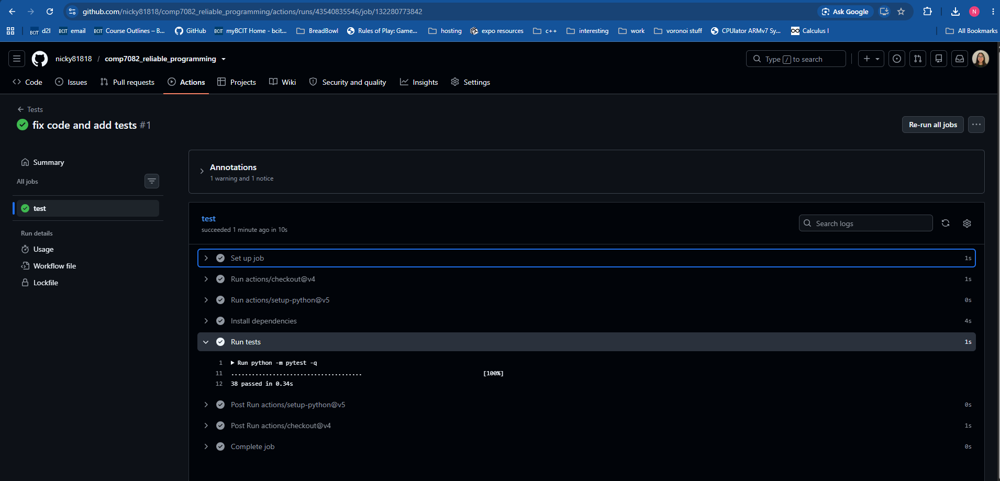

# Defects found and fixed

## Assumptions
- Coupons **replace** each other (never stack). `FREESHIP` has no effect on the total because the app has no shipping charge.
- A `request_id` identifies one checkout attempt. Repeating it returns the original result (paid *or* declined) and never charges again. To retry after a decline, use a new `request_id`.
- A cart whose total is 0 (e.g. `SAVE15` on a 9.99 cart) is not sent to the gateway.
- Stock that is no longer sufficient when a saved cart is loaded is silently skipped.
- Money is rounded to cents with half-up rounding.

## Defects

| # | Where | What could go wrong | Fix |
|---|-------|---------------------|-----|
| 1 | `repository.get_product`, `get_saved_cart` | SQL built with f-strings → **SQL injection** (`x' OR '1'='1`) | Parameterised queries (`?`) |
| 2 | `cart.add_item` | Zero, negative, float, string or bool quantities accepted (negative adds "stock" / negative totals) | Quantity must be a positive `int`; otherwise returns `False` |
| 3 | `cart.add_item` | Stock check ignored what was already in the cart (3 + 3 laptops with 5 in stock) | Check `already_in_cart + quantity <= stock` |
| 4 | `cart.apply_discount` / `total` | Discount was a stored snapshot → **stale after the cart is edited** | Total is derived from current lines + selected coupon each time |
| 5 | `cart.apply_discount` | Coupons **stacked** (applying WELCOME10 twice = 19 % off) | Only one coupon is stored; applying replaces it |
| 6 | `cart.apply_discount` | `SAVE15` could drive the total **negative**; floats gave wrong cents (80.865) | `max(total, 0)`; `Decimal` arithmetic with half-up rounding to cents |
| 7 | `cart.load` | Calling `load()` twice **doubled quantities** | `load()` replaces the lines (idempotent) |
| 8 | `cart.remove_item` | Negative/zero quantity accepted (a negative removal *adds* items); list mutated while iterating | Validate quantity; look up the line first, then mutate |
| 9 | `checkout.checkout` | Stock decremented **before** payment and never restored → a declined/failed payment lost inventory | Reserve stock → charge → **release stock if not paid** |
| 10 | `checkout` / `repository.update_stock` | No stock check at checkout, no transaction: overselling and negative stock | `reserve_stock` is one transaction with `UPDATE … WHERE stock >= ?`; all-or-nothing; `CHECK (stock >= 0)` in schema |
| 11 | `checkout.checkout` | **Repeated request charged and decremented again** (`request_id` never used) | Missing id rejected; repeat returns stored order; unique index on `(user_id, request_id)` |
| 12 | `checkout.checkout` | Cart was **cleared even when payment failed/declined** | Cart cleared (and coupon reset) only when status is `paid` |
| 13 | `checkout.checkout` | **Payment token printed to the log** | Removed; test asserts it is never printed |
| 14 | `checkout.checkout` | Useless "large order" block (dead code); non-bool/malformed gateway response could crash | Removed; `response.get('approved')` |
| 15 | `repository.list_orders` | Took `user_id` but **returned every user's orders** | `WHERE user_id = ?` |
| 16 | `repository` (all methods) | Connections leaked on exceptions; no rollback | `_conn()` context manager: commit/rollback + always close |
| 17 | `cart` / `repository` | `print()` for errors in business logic | Methods return `False` / status codes instead |

## Known limitations
- If `save_order` itself fails *after* a successful charge there is no refund call (the supplied gateway has none).
- Two truly simultaneous checkouts with the same `request_id` could both reach the gateway; the unique index stops a duplicate order row but not the second charge.

## Test results
Paste your real output here after running `python -m pytest -q` locally and on GitHub:

```
......................................                                                                                            [100%]
38 passed in 2.82s
```

GitHub Actions run: 
https://github.com/nicky81818/comp7082_reliable_programming/actions/runs/43540835546/job/132280773842


AI was used as a tool for this assignment.
